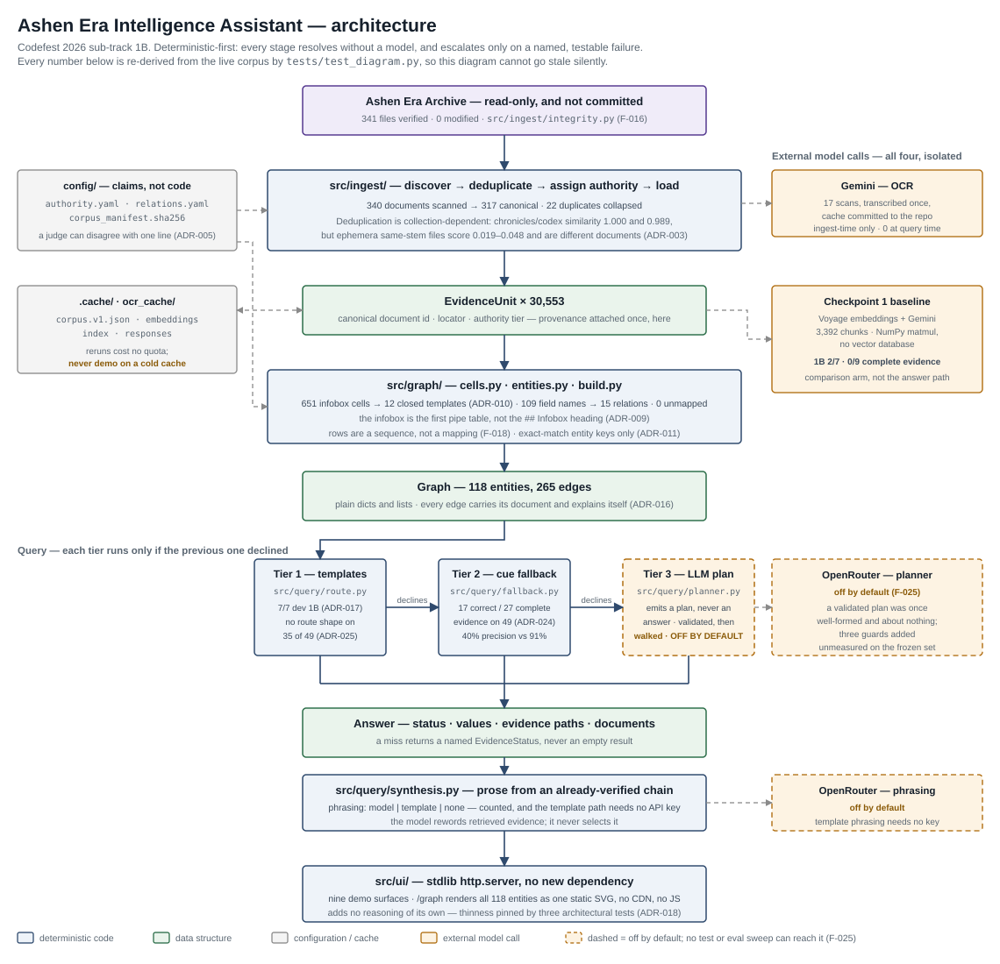

# Architecture



> Every number in the diagram above is re-derived from the live corpus by
> `tests/test_diagram.py`. If a measurement moves and the picture does not, the
> suite goes red. See [ADR-022](decisions.md) for why the diagram is a
> hand-authored SVG and why it is pinned this way.

The system is one pipeline with four stages and a strict rule running through
all of them: **each stage resolves deterministically first, and escalates to a
model only on an explicit, testable failure condition.** Nothing escalates
because it "might do better".

## 1. Corpus → evidence units

`src/ingest/` — `python -m src.ingest.pipeline`

The archive is read-only and is not committed (~123 MB; the README documents the
download). `src/ingest/integrity.py` hashes all **341 files** against
`config/corpus_manifest.sha256` before anything trusts a measurement — we once
lost 36 files to an editor that "helpfully" reformatted them (F-016).

Ingestion runs `discover → deduplicate → assign authority → load`, producing
**317 canonical documents** from **340 scanned**, and **30,553 `EvidenceUnit`s**.
An `EvidenceUnit` is one citable block carrying its canonical document id, its
locator and its authority tier. Provenance is attached **once, here**, so the
graph builder, the vector index and the conflict resolver all inherit it rather
than reconstructing it three times and disagreeing.

The load-bearing decision is that **deduplication is collection-dependent**
(ADR-003). `chronicles/` and `codex/` ship the same work as `.docx` and `.pdf`
(similarity 1.000 and 0.989) and must be collapsed; `ephemera/` same-stem files
score 0.019–0.048 and are *different documents* — collapsing those would delete
evidence. A global dedup rule is wrong in one direction or the other.

## 2. Evidence units → graph

`src/graph/` — `python -m src.graph.build`

The graph is built from wiki infobox rows, one row at a time, into **117
entities and 267 edges** across **15 relations**, with **0 unmapped field
names**. It is a Python dict of lists. Three measured findings shape the parser:

- **The infobox is the first pipe table, not the `## Infobox` section** (ADR-009).
  Six pages have no such heading; one of them is hop 2 of `1b_003`.
- **Cells are sentences, and the sentence set is closed** (ADR-010). **12
  templates cover all 651 cells** — including two-argument clauses
  (`Fought in [[Conflict]] for [[Faction]]` is *one ternary fact*, and emitting
  two edges from the subject asserts something false) and `since <year>`
  qualifiers, which belong on the edge rather than glued into the node name.
- **Rows are a sequence, not a mapping** (F-018). Five pages repeat a field name;
  `the_ashen_vanguard.md` carries `Belligerent` three times. `fields[name] = value`
  keeps the last and drops the rest, silently.

Entity resolution is **exact match only** (ADR-011). `caedmon_fellgard` and
`ederon_fellgard` are 0.839 similar and are different people, so no fuzzy
threshold may ever pick a winner. A near miss is *reported* to the user at ≥0.90
similarity and still resolved by nobody but them (ADR-021).

An unmapped field name is **reported, never swallowed** — a relation expressed
under a field nobody mapped is an edge that silently never exists, which is
indistinguishable from the corpus not asserting it.

## 3. Question → answer: three declining tiers

`src/query/` — `python -m src.query.engine "<question>"`

Each tier runs only if the one before it declined, and each declines rather than
guesses. A question no tier can route ends at a **named `EvidenceStatus`**, never
at an empty result or an invented answer.

| Tier | Module | Measured |
|---|---|---|
| 1 — templates | `route.py` | **7/7** dev 1B (ADR-017); matches no route shape on **35 of 49** independent questions (ADR-025) |
| 2 — cue fallback | `fallback.py` | **17 correct / 27 complete evidence** on 49, vs 10 / 11 for templates alone (ADR-019, evidence count updated by ADR-024). 40% precision against templates' 91% |
| 3 — LLM plan | `planner.py` | Emits a validated *plan*, never an answer. **Off by default**; unmeasured on the frozen set |

**Never quote the 7/7 without the 35/49 beside it.** 7/7 measures fit to the
seven development questions; 35/49 measures routing capability on questions
written independently and frozen before either router ran. Reporting the first
alone would misrepresent the system.

Tier 3 is where an LLM first influences what gets traversed, and `validate_plan`
bounds that. F-025 is the day we learned that bounding *well-formedness* is not
enough: a model returned a schema-valid, name-checked, hop-bounded plan for
"What color is the sky in the Ashen Era?" by latching onto the word "Ashen", and
the engine walked it into a confident, fully cited answer to a question nobody
asked. Three guards followed — grounding, an explicit decline channel, and a
closed answer-type vocabulary — and the tier was made **opt-in**, so no test or
eval sweep can spend quota or depend on a provider being reachable.

## 4. Answer → prose → screen

`src/query/synthesis.py` turns an already-verified chain into prose. The model
**rewords retrieved evidence; it never selects it**, and `phrasing: model |
template | none` records which path ran. The template path needs no API key, so
the demo works with the network off.

`src/ui/` is the stdlib `http.server` and no new dependency (ADR-018). It renders
nine demo surfaces, including `/graph`, which draws all **117 entities** as one
static SVG with no CDN and no JavaScript. The UI **adds no reasoning of its own**
— three architectural tests enforce that, because a presentation layer that
quietly re-ranks results makes every measurement above meaningless.

## Where models are called, and where they are not

Four places, all isolated, none of them in the traversal that produces an answer:

| Call site | Provider | Status |
|---|---|---|
| `src/ingest/ocr.py` | Gemini | Ingest-time only. 17 scans, transcribed once, cache committed. **0 calls at query time** |
| `src/baseline/` | Voyage + Gemini | Checkpoint 1 baseline — the comparison arm, not the answer path |
| `src/query/planner.py` | OpenRouter | **Off by default** (F-025) |
| `src/query/synthesis.py` | OpenRouter | **Off by default**; template phrasing needs no key |

Graph traversal — the part that actually produces the answer — is plain Python
over a parsed data structure.

## Deliberately not used

- **No graph database.** 117 entities and 267 edges is a dict.
- **No vector database.** 3,392 chunks is a NumPy matrix multiply in milliseconds.
- **No agent framework.** LangChain / LangGraph / CrewAI would be code we did not
  write.

The binding reason is not performance. The competition requires every team member
to explain, justify and modify **any part** of the submission on demand, and
inability to do so is disqualifying. A dependency nobody on the team can defend
to a judge is a liability regardless of what it saves.

## Reproducing every number on this page

```bash
python -m src.ingest.integrity                  # 341 files, 0 modified
python -m src.ingest.pipeline                   # 340 -> 317 docs, 30,553 units
python -m src.graph.build                       # 117 entities, 267 edges
python -m eval.probes.corpus_shape              # 651 cells, 12 templates
python -m eval.run_eval --checkpoint baseline   # Checkpoint 1 (cached, free)
python -m comparison.harness                    # the 35/49 and 17/27 figures
python -m pytest                                # the whole suite
```

**All evaluation numbers are PROVISIONAL until two people verify
`eval/answer_key.json`** — measured status today: 6 `single_review`, 2 `draft`,
1 `unresolved`, all reviewed entries by the same reviewer (F-015).
