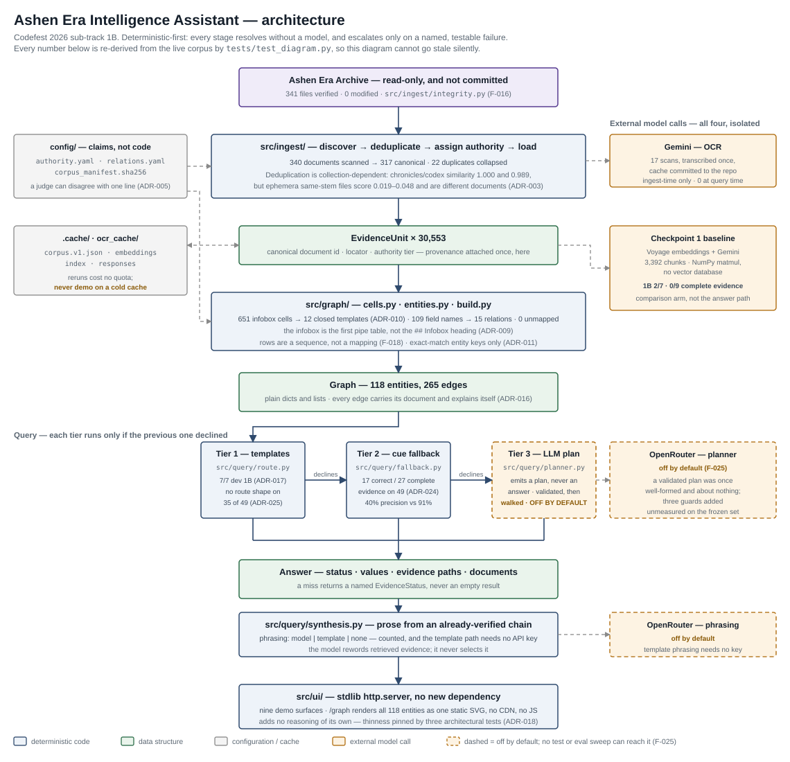

# Ashen Era Intelligence Assistant

**SLIIT Codefest 2026 — AI Competition, powered by IFS**
**Sub-track 1B — Connecting Facts Across Thousands of Pages**

**Demonstration video:** *[UNLISTED YOUTUBE LINK — paste before submitting]*
**Repository:** `github.com/mithilyr/CODEFEST---AI-Challenge`

Every figure in this report was re-derived from the live corpus on 2026-09-09.
The command that reproduces each one is in `docs/numbers.md`.

---

## 1. The problem, and why the obvious solution fails

Sub-track 1B asks for answers that no single document contains. Dev question
`1b_007` — *"Which accord was ultimately won by the faction of which Ederon
Fellgard is a member?"* — is the shape of the whole track:

- `wiki/ederon_fellgard.md` records his membership and never mentions an accord.
- The page naming that accord's victor never mentions Ederon Fellgard.

The two documents share no linking vocabulary, and hop 2 is a *reverse* lookup:
given a faction, find the conflict it won. Similarity search has a mechanism for
neither.

We did not assume this. We built the obvious solution first and measured it. A
competent Voyage-embedding vector RAG baseline over the deduplicated corpus:

| Checkpoint 1 — vector RAG baseline | |
|---|---|
| 1B answer correctness | **2 / 7** |
| **Complete evidence** | **0 / 9** |

Not one question retrieved every document its answer needs. **Three of seven
reached neither required document** (recall 0.00), so the join never got a chance
to fail. Both questions scored "correct" reached one document of the two or three
they needed — right answers by the wrong route.

Raising `k` retrieves more passages. It cannot manufacture a join between two
documents that share no vocabulary. That is a structural failure, not a tuning
problem, and it is why this system is graph-first.

*The challenge document describes 415 documents; the shipped archive contains
340 files (341 including `sample_questions.json`), deduplicated to 317 canonical
documents and 30,553 evidence units. We report what we measured.*

---

## 2. Solution overview and architecture

One pipeline, four stages, with a rule running through all of them: **each stage
resolves deterministically first and escalates to a model only on an explicit,
testable failure condition.** Nothing escalates because it "might do better."

**Ingest.** SHA-256 integrity check → discover → deduplicate → assign authority
→ load. 317 canonical documents, **30,553 evidence units**, each carrying its
document id, locator and authority tier. Provenance is attached **once, here**,
so every downstream consumer inherits it rather than reconstructing it three
times and disagreeing.

**Graph.** Wiki infobox rows → **118 entities, 265 edges**, 15 relations, **0
unmapped field names** — a plain Python dict of lists.

**Query — three declining tiers**, each running only if the previous declined,
each declining rather than guessing:

| Tier | Mechanism | Measured |
|---|---|---|
| 1 | Four deterministic templates | 7/7 dev 1B; no route shape on **36 of 49** frozen questions |
| 2 | Deterministic cue routing | 40% precision, against templates' 91% |
| 3 | LLM emits a validated *plan*, never an answer | **Off by default**; measured once (ADR-048): fires on 4/55, all correct |

A question no tier can route ends at a **named `EvidenceStatus`** — never an empty
result, never an invented answer — and the page renders the partial evidence it
did establish, with citations.

**Cross-collection attestation.** For every pair of entities the graph connects,
non-wiki passages naming *both* ends attach with document, locator, collection and
tier: **259 of 265 edges (97.7%)** — 421 codex, 115 chronicle, 26 ephemera
attestations. Co-mention is **not** proof, and the page says "also attested in",
never "confirms"; a test forbids the words *confirms* and *proves* in the output.

**Deliberately not used:** no graph database (265 edges is a dict), no vector
database (a NumPy matmul), no agent framework. The binding reason is not
performance: §4.1 requires every team member to explain, justify and modify any
part on demand, and a dependency nobody on the team can defend is a liability
regardless of what it saves.

---

## 3. Key technical decisions

**Traversal is constrained to a named relation per hop.** Measured: an
unconstrained two-hop search returns **5–87 candidate paths**, and the shortest
path landing on the right answer is frequently wrong about *why*. Three dev
questions ask which conflict a faction won; the shortest route runs through
`belligerent_in` — the faction *fought in* it — where the truth requires
`victor_of`. Both edges exist, both are two hops, both end on the same node.
Constraining collapses 5–87 candidates to 1–14 and makes the relation sequence
*be* the claim being audited. Fighting in a war is not winning it.

**Entity resolution is exact-match only.** `caedmon_fellgard` and
`ederon_fellgard` are 0.839 similar, are different people, and the second is the
subject of `1b_007`. No fuzzy threshold may silently pick a winner; a near-miss at
≥0.90 is *reported* and resolved by nobody but the user.

**Configuration is not code.** `config/relations.yaml` maps 109 infobox field
names onto 15 relations *and* declares which collections build the graph. Adding
vocabulary is a YAML edit — verified live, two new field names took a test graph
from 12 to 14 edges with no code change. A build matching no collection now
raises an error naming what the corpus contains; it previously produced zero
edges in silence.

**Scoring is deterministic, not an LLM judge.** Three reasons: quota (~20
requests/day/model), reproducibility (a judge that scores differently across runs
turns a baseline into an estimate), and defensibility (a teammate can defend 40
lines of matching rules; nobody can defend a model's opinion). It carries a
negation guard, because *"there is no mention of who the victors were"* contains
the phrase "the victors were" and a naive substring match scores it correct.

**Ground truth is validated independently.** `eval/completeness.py` imports
nothing from `src/graph/`: ground truth validated by the system under test is not
ground truth.

---

## 4. What works, what does not, and what we got wrong

### What works

| | |
|---|---|
| Dev 1B questions | **7 / 7** correct, with complete evidence |
| Shipped three tiers, 49 frozen questions | **22 correct / 31 complete evidence** (templates alone: 10 / 11) |
| With the opt-in planner tier also on | **26 correct / 35 complete evidence** — fires on 4/55, all correct (ADR-048) |
| Unanswerable questions | **6 of 6** honestly refused |
| Cross-collection attestation | 259 of 265 edges |
| Entities the corpus treats as first-class with no graph node | **0** |
| Tests | **497**, zero network calls |

### The number that matters more than 7/7

**The four templates match no route shape on 36 of 49 independently authored
questions. On the 21 novel ones, they match one.**

Those 55 questions were written by team members with **no access** to either
router, to `src/query/`, or to `config/relations.yaml` — that last withheld
specifically because it is the cue router's vocabulary source, and an author who
read it would have tested the vocabulary rather than the router. The set was
frozen with its sha256 recorded *before either router ran*.

So **7/7 measures fit to seven development questions; 36/49 measures routing
capability.** We do not quote the first without the second. A judge can verify
the freeze date and hash independently of anything we assert.

### Limitations

- **The graph reads wiki infobox pipe tables only.** The other three collections
  are ingested and corroborate edges but build none. A wiki using YAML
  frontmatter or HTML tables would build zero edges.
- **Every acceptable path in the answer key is two hops.** A three-hop set we
  wrote ourselves answers 3 of 3 — but through the cue tier, at 40% precision,
  and it is not two-person verified.
- **The LLM planner tier's contribution is narrow, measured once.** Off by
  default; the one measured sweep (ADR-048) changed the outcome on 4 of 55
  frozen questions — real signal that it recovers *something* the deterministic
  tiers miss, not evidence of a general improvement. Not re-run routinely: it
  spends daily OpenRouter quota and drifts with the provider's free lineup.
- **It does not update automatically.** A document added while the server runs is
  invisible until a reindex — about six seconds, reported with before/after
  counts.
- **No authentication, audit log, persistence or observability.** Single process,
  in-memory. Appropriate for a prototype; not for a plant-maintenance deployment.

### Every evaluation number here is PROVISIONAL

`eval/answer_key.json`: **0 of 9 entries confirmed** — 7 `single_review` by a
single reviewer (Mithil, who also implemented the system), 2 `draft`. No second
human reviewer was available before the deadline. Independent enumeration
(`eval/completeness.py`) reports **0 recall risks**, which is strong evidence the
key is not too *narrow*; it is weak evidence that each answer is *right*. An AI
re-derivation agreed with all nine and does not count — not a second human, not
blind. The harness prints the warning itself on every run. Nothing has been
relabelled to look better.

### Approaches we tried and rejected

38 failures are logged in `docs/failures.md` with the measurement that killed
each. Five that changed the design:

- **F-025 — a validated plan, relevant to nothing.** The LLM planner returned a
  schema-valid, name-checked, hop-bounded plan for *"What color is the sky in the
  Ashen Era?"* by latching onto the word "Ashen", and the engine walked it into a
  confident, fully cited answer to a question nobody asked. Three guards followed
  and the tier became opt-in.
- **F-016 — trusting that a read-only corpus stayed read-only.** An editor
  rewrote 36 files and left a phantom document that ingested as real. The SHA-256
  integrity check exists because of this.
- **F-015 — a single careful reviewer.** A reviewer read `1b_006`, reported
  `confidence: high`, and listed two valid answers. The corpus documents
  **fourteen** — membership is recorded in two disjoint places with zero overlap,
  and a human reading from one direction sees one half. The mitigation is not
  another reviewer; it is enumeration that reads both directions by construction.
- **F-008 — structural claim extraction without stripping emphasis.** The
  ephemera wrap competing values in `**bold**`. An extractor that ignores it finds
  **zero** conflicts corpus-wide and reports full confidence — silent failure.
- **ADR-013 CORRECTION — our own conclusion, overturned.** We predicted the 1C
  conflict questions would defeat a naive baseline. They did not: the codex
  announces its own authority in prose, and the model follows that signal without
  our tier model. We kept the measurement and deleted the claim.

---

## 5. AI Usage Disclosure

Full detail in `ai_usage/ai-usage-disclosure.md`; complete conversation logs are
exported as plain text in `ai_usage/`.

**Tools.** Claude Code as the coding assistant throughout. Gemini for OCR of the
17 scanned ephemera (ingest-time only; transcripts committed, **0 calls at query
time**). Voyage embeddings and Gemini for the Checkpoint 1 baseline — the
comparison arm, not the answer path. OpenRouter for the opt-in planner and
phrasing tiers, both off by default.

AI used to **build** the system is disclosed above; AI used **inside** the
answer path is confined to ambiguous entity resolution, unmatched question shapes,
and rewording evidence already retrieved. Traversal — the part that produces the
answer — is plain Python.

**Decisions the team made, not the assistant.** Recorded across 48 ADRs, with the
overturned assumption left visible each time: collection-dependent deduplication
(ADR-003); exact-match-only entity resolution, refusing fuzzy matching (ADR-011);
making the LLM tier opt-in after F-025; keeping the fourteen-name answer set and
marking the entry unresolved after F-015; and reversing our own published
conclusion in the ADR-013 correction. The deterministic-first rule and the
measure-before-asserting rule were written into `CLAUDE.md` by the team before the
assistant was pointed at the problem.

---

## 6. Team, roles and contributions

Full detail in `TEAM.md`.

| Name | Role | Where the work is visible |
|---|---|---|
| **Mithil** | Implementation lead; author of record on the git history; answer-key reviewer | Every commit; `github.com/mithilyr/CODEFEST---AI-Challenge` |
| **Yasiru** | Parallel prototype; source of the adopted cue-router design | `github.com/YasiruRF/delphi` — measured against ours and partially adopted (ADR-019) |
| **Tatiana** | Question authoring; code review | The frozen 55-question robustness set; review passes on the implementation |
| **Kenolee** | Question authoring; code review | The frozen 55-question robustness set; review passes on the implementation |

**On the commit history, stated rather than left to be found.** All commits in
this repository carry a single author, although the team is four people. We have
not rewritten or backdated the log to distribute authorship: §5.2 asks the history
to reflect the team's actual working process, and a redistributed log would
satisfy the letter of that line while defeating its point. The log is accurate and
incomplete as a record of who contributed what; `TEAM.md` is the correction.

The independently authored question set is the clearest case of work that leaves
no commit behind — and it is the reason the 36/49 figure is worth anything at all.
